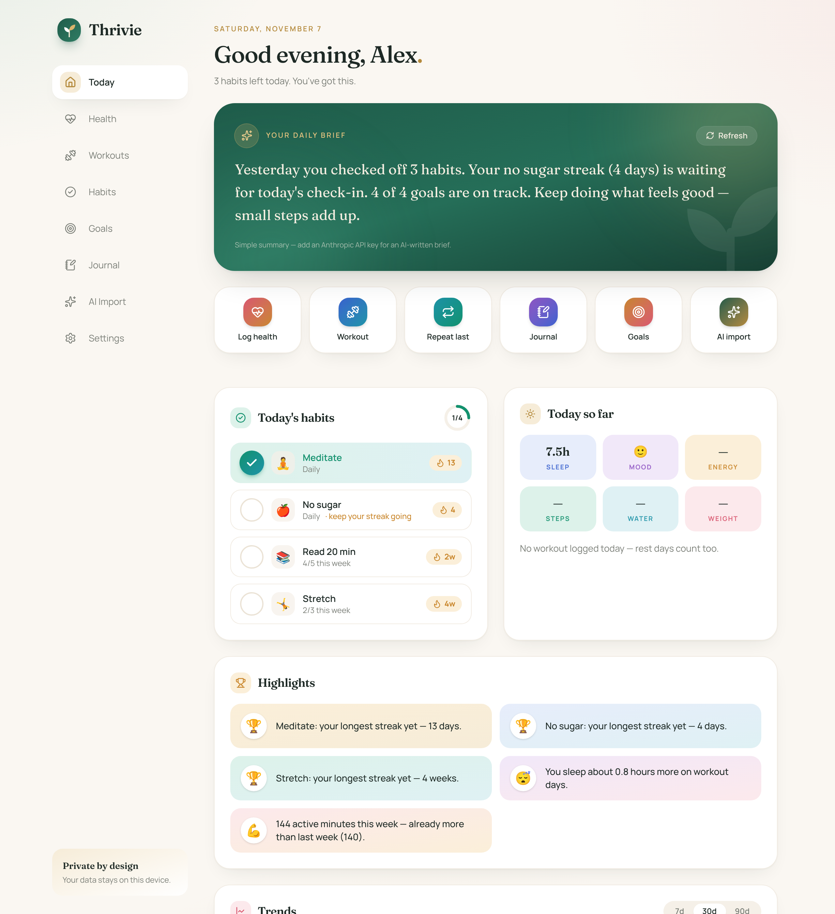
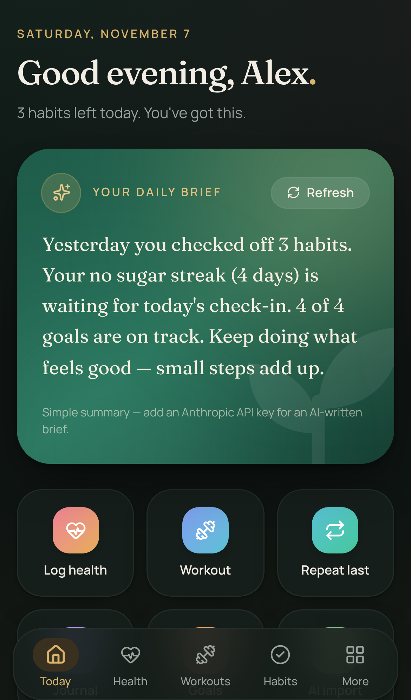

# 🌱 Thrivie

<p align="center"> </p>

A calm, private, mobile-friendly wellness tracker for **health, workouts, habits, goals and a journal**, with a visual dashboard, a daily brief, and an **AI Notes Import** that turns messy notes-app text into structured entries.

- **Simple.** Most entries take a few taps: one-tap habit check-offs, "repeat last workout", and a quick-log sheet on the dashboard.
- **Local-first and private.** Everything is stored in a local SQLite file. Data leaves your machine only when you use the AI features (see [Privacy](#privacy)).
- **Installable.** Works as a PWA on phones and desktops, with light and dark mode.
- **Calm, luxe design.** Warm ivory and deep emerald with champagne-gold accents, Fraunces serif headings, and a jewel tone for each area (rose for health, sapphire for workouts, emerald for habits, amber for goals, plum for the journal). Fonts are bundled locally, so the app makes no font requests.
- **U.S. units by default** (lb, mi, fl oz). You can switch to metric in Settings at any time without losing data.

> Thrivie is for personal tracking only. It isn't medical advice.

---

## Quick start (local)

Requirements: **Node.js 20+** (tested on 22) and npm.

```bash
git clone <this repo> thrivie && cd thrivie
npm install                 # also generates the Prisma client
cp .env.example .env        # optional keys: see the comments in the file
npm run setup               # creates the SQLite DB + a demo account with ~30 days of data
npm run dev                 # http://localhost:3000
```

Sign in with **demo@thrivie.app / thrivie-demo**, or create your own account. A new account starts empty. The welcome screen offers sample data if you want to look around first.

### Useful scripts

| Command | What it does |
|---|---|
| `npm run dev` | Start the dev server |
| `npm run build && npm start` | Production build and server |
| `npm test` | Unit and integration tests (Vitest), including the data-isolation tests |
| `npm run lint` | Type-check |
| `npm run db:migrate` | Apply database migrations (local file, or Turso when `TURSO_*` is set) |
| `npm run db:seed` | Reset **only the demo account** with fresh sample data |
| `npm run db:reset` | Delete the local database and start over |
| `npm run db:new-migration name` | Create a migration after you change `prisma/schema.prisma` |
| `npm run vapid` | Generate the keys for push reminders |

---

## Multiple users and privacy

- **Accounts**: people sign up with email and password. Passwords are hashed with scrypt. Sessions are random tokens in an httpOnly cookie, and only a hash of each token is stored. Repeated wrong passwords are rate-limited.
- **Every record belongs to one user.** All app queries go through a per-user database client (`src/lib/db.ts`) that adds the signed-in user to every read, update and delete, and stamps them on every new record. A user can't read, change or attach to another user's data even by guessing IDs. `tests/isolation.test.ts` checks this against a real database.
- **Photos and voice notes** are only served to their owner. Everyone else gets 401 or 404.
- **Who can sign up**: on a public URL, set `SIGNUP_CODE` so only people you give the code to can create accounts, or set `ALLOW_SIGNUP=false` once everyone has joined.
- **Deleting**: Settings → *Delete all data* clears your entries. *Delete account* removes the account and everything in it.

## Free hosting: Vercel + Turso (recommended)

Both have free plans with no credit card, and the whole setup can be done in a web browser, even on an iPad. Vercel runs the app. Turso is a hosted SQLite database. The database tables are created automatically on every deploy, and the push-notification keys are generated automatically on first use.

1. **Database (Turso).** Sign up at [turso.tech](https://turso.tech) (GitHub sign-in works), create a database, then copy its **URL** (`libsql://…`) and create a **token**.
2. **Deploy (Vercel).** Sign up at [vercel.com](https://vercel.com) with GitHub, choose **Add New → Project**, import this repository, and add these **Environment Variables** before deploying:
   - `TURSO_DATABASE_URL`, `TURSO_AUTH_TOKEN`: from step 1
   - `SIGNUP_CODE`: a code you give to the people you want to join
   - `CRON_SECRET`: any long random string
   - `ANTHROPIC_API_KEY`: optional, turns on the AI features
3. **Reminders schedule (optional).** On [cron-job.org](https://cron-job.org), create a job that calls
   `https://<your-app>.vercel.app/api/cron/reminders?secret=<CRON_SECRET>` **every hour**.
4. Open your `https://….vercel.app` URL, create your account with the signup code, and add it to your Home Screen.

Vercel deploys the repository's production branch (`main` by default). Merge the app branch into `main`, or change the production branch under Vercel → Project → Settings → Git. Every later push redeploys automatically and applies any new database migrations.

> Running locally instead? `npm run db:migrate` with `TURSO_*` set also migrates Turso by hand. To self-host on an always-on machine, `npm run build && npm start` with the SQLite file works. Put it behind HTTPS (for example Caddy) so it can be installed and send reminders.

### On your phone
- **iPhone (iOS 16.4+)**: open the URL in Safari, tap **Share → Add to Home Screen**, then open Thrivie from the Home Screen. On iPhone, push reminders only work from the Home Screen app.
- **Android**: in Chrome, tap **⋮ → Install app**.

## Features

### Modules
1. **Health**: weight, sleep (hours and 1–5 quality), water, mood, energy, steps, and any custom metrics (e.g. resting HR). Every field is optional. Choosing a date loads that day's log so you can edit it. Trend charts for 7, 30 or 90 days.
2. **Workouts**: type (strength, cardio, mobility, sport, other), duration, intensity, optional exercises (sets × reps @ weight) or distance and pace (pace is calculated if left blank). Includes **Repeat last** and a weekly-volume chart stacked by type.
3. **Habits**: daily or X-times-per-week habits with one-tap check-off. Current and best streaks (counted in weeks for weekly habits), a heatmap per habit, and a 6-month overview.
4. **Goals**: target, unit, start date and deadline. Progress is either **manual** or **linked** so it updates automatically:
   - workouts: count, minutes, or distance, for one type or all
   - health metrics: total steps, total water, average sleep, or reach a weight
   - a habit: number of check-ins

   Each goal shows a progress bar with a "steady pace" marker and an on-track or behind status.
5. **Journal**: free-text entries with optional mood and prompts ("What went well today?"). Full-text search with highlighted matches.

### Dashboard
- **Today**: greeting, daily brief, quick-add buttons, today's habits to check off, and a snapshot of what's logged today.
- **Highlights**: wins and patterns **computed in code** (streak records, sleep on workout days vs rest days, mood on active days, weekly volume vs last week, distance, steps trend, goals on track). When an API key is set, the AI only rewords these facts. It never invents numbers.
- **Charts**: weight, sleep and mood trends (7/30/90-day toggle), weekly workout minutes, habit heatmap, goal progress bars.
- **Daily brief**: 3–5 sentences generated **once per day** from the last 7 days and cached in the database. It covers yesterday's recap, streaks at risk, goal status, and one gentle suggestion. A **Refresh** button regenerates it.

### Weekly review
Pick any week (Monday to Sunday) to see workouts, sleep, mood, steps, habit completion and goals. **Write my review** produces a short reflection with your wins and one gentle idea for the next week. The numbers are computed in code, the AI only writes the prose, and it's cached per week.

### Photos and voice notes in the journal
Attach photos (resized on your device to about 1600px JPEG before upload), record voice notes (up to 2 minutes), or **dictate** text with your browser's speech recognition. Attachments are stored in the database, so hosting doesn't need separate file storage, and only you can load them. They aren't included in the JSON backup.

### Reminders
Settings → **Daily reminder** sends one push notification a day at the hour you pick, and only if you still have habits to check off or haven't logged anything. The message names a streak that's at risk when there is one. **Send a test** checks your device. This needs the VAPID keys and an hourly scheduler (see hosting above).

### Apple Health and Android sync
Settings → **Health sync** creates a personal token (shown once; you can revoke it any time). Your phone then posts JSON to `/api/ingest`:

```bash
curl -X POST https://<your-app>/api/ingest \
  -H "Authorization: Bearer thr_…" -H "Content-Type: application/json" \
  -d '{"steps": 9120, "sleepHours": 7.4, "weight": 171.6,
       "workouts": [{"type": "running", "durationMin": 32, "distance": 3.1}]}'
```

Accepted fields: `date` (defaults to today), `steps`, `sleepHours` or `sleepMinutes`, `weight` (+`weightUnit`), `water` (+`waterUnit`), `mood`, `energy`, `restingHeartRate`, `custom` ({name: number}), and `workouts` (each with `type`, `title`, `durationMin`, `distance`, `distanceUnit`). Apple workout names such as "Running" or "Yoga" are mapped to Thrivie's types. Numbers sent as text (which Shortcuts often does) are accepted. Sending the same day again updates it without duplicating workouts.

**iPhone:** use the Shortcuts app with *Find Health Samples*, then *Calculate Statistics*, then *Get Contents of URL* (POST, JSON). Run it daily with an automation; step-by-step instructions are in the app. **Android:** use Tasker or any Health Connect exporter that can send a web request.

### AI Notes Import
Paste text from Apple Notes, Google Keep, Notion and similar apps. It can be messy, abbreviated, and cover several days:

```
Mon - ran 5k 28min, slept 6h felt tired. pushups 3x15. no sugar ✅ meditated ✅. weight 172.
Tues: rest day, 8h sleep, journaled about work stress
```

How it works:
1. A server-side call asks Claude to return **only JSON** that matches a strict schema (health logs, workouts, habit check-ins, goal updates, journal entries). Each entry has a date, the raw date text, and confidence scores per entry and per field.
2. The response is validated with **Zod**. Code fences and stray prose are tolerated. Numeric strings and out-of-range ratings are coerced or clamped. Invalid entries are dropped individually. If nothing usable comes back, the screen shows a clear error with a **Retry** button.
3. **Dates are resolved in code.** Strings like "Mon", "yesterday", "3 days ago", "11/3" and "Nov 3rd" are resolved against today in *your* timezone, and that result wins over the model's own date. Notes describe the past, so "Mon" means the most recent Monday.
4. **Units**: bare numbers use your unit setting, so "weight 172" means 172 lb in U.S. mode. Explicit units ("5k", "3 mi", "80 kg") are converted.
5. **Habits and goals are matched by name** (fuzzy: "meditated" matches "Meditate"). Anything that doesn't match shows as a **"New habit?"** suggestion that you can create or link. Nothing is created silently.
6. **Review screen**: entries are grouped by date and type. Each one can be edited, removed or approved. Low-confidence entries and fields are highlighted. **Approve all** and **Save** are at the top.
7. **Duplicate detection**: existing health logs (keep existing / overwrite / skip), same-type workouts on the same day, habits already checked off, repeated journal text, and progress for goals that update automatically.

---

## Privacy

- Data is stored in the server's database (a local SQLite file or your Turso database), separated per account. There are no analytics or third-party scripts.
- Only two features send data out, both to **Anthropic's Claude API** and both server-side (the API key never reaches the browser):
  - **AI Notes Import**: the text you paste, plus your habit and goal names (used for matching).
  - **Daily brief and highlights**: a compact summary of the last 7 days (averages, counts, habit and goal names, computed highlights). **Journal text is never sent.**
- Both are explained in the UI (on the import screen, under the brief, and in Settings).
- **Your data** in Settings has a full JSON backup, per-table CSV exports (in your display units), JSON restore, and "Delete all data".

## Tone and safety
The AI prompts require encouraging, non-judgmental language: no shaming about weight, food or missed days, and no medical advice or diagnoses. Weight comes up in highlights or the brief only as progress toward a goal you set. Requests use the server-side refusal fallback (`fallbacks: "default"`) on models that support it, and every AI failure falls back to code-written text.

---

## Tech stack

- **Next.js 15** (App Router, Server Components and Server Actions) + **TypeScript** + **Tailwind CSS 4**
- **SQLite via Prisma 6**
- **Recharts** for charts. The jewel-tone chart palette was checked for color-blind separation in both light and dark mode.
- **Fraunces + Manrope** variable fonts, self-hosted via `@fontsource-variable`
- **Anthropic TypeScript SDK** for AI. The model is configurable (default `claude-sonnet-5-5`).
- **Zod** for validating every input and AI response
- **Vitest** for tests

### Project layout

```
prisma/
  schema.prisma        data model (dates are "YYYY-MM-DD" in the user's timezone; values stored metric)
  seed.ts              ~30 days of realistic sample data
src/app/
  page.tsx             dashboard
  health|workouts|habits|goals|journal/   module pages + forms
  import/              AI Notes Import + review screen
  settings/            settings, export/restore, delete
  actions.ts           server actions for all manual CRUD
  api/import/{parse,commit}  AI parse → review → commit
  api/brief            cached daily brief
  api/export, api/backup     JSON/CSV export and JSON restore
  manifest.ts, icons/  PWA manifest and icons (public/sw.js = service worker)
src/lib/
  dates.ts             timezone-aware "today" + relative date resolution
  units.ts             U.S. ↔ metric conversion
  stats.ts             streaks, goal pace/status
  insights.ts          highlights computed from data
  queries.ts           DB loaders (habit views, goal progress, ranges)
  ai.ts                Claude client wrapper (server-only)
  brief.ts             daily brief context, prompt, cache, fallback
  import/schema.ts     AI JSON schema (Zod), system prompt, parser
  import/normalize.ts  date/unit normalization, habit/goal matching
  import/server.ts     duplicate detection + transactional commit
tests/                 date resolution, AI parsing/validation, normalization, streaks/goals/insights
```

### Design notes
- **Storage is always metric.** Switching between U.S. and metric only changes display and input, so it is lossless.
- **"Today" comes from the timezone set in Settings**, not the server clock. On a UTC server the seed script defaults to `America/New_York`. Settings has a "Use this device" button to pick up your local zone.
- AI output is never trusted directly. It is parsed, validated, normalized and shown for review before anything is written, and writes run in a single transaction.

## Troubleshooting
- **"AI import needs an ANTHROPIC_API_KEY"**: add the key to `.env` and restart the server.
- **"Model … wasn't found"**: check `ANTHROPIC_MODEL` in `.env`.
- **Dates look off by a day**: set your timezone in Settings.
- **Start fresh**: `npm run db:reset`.
