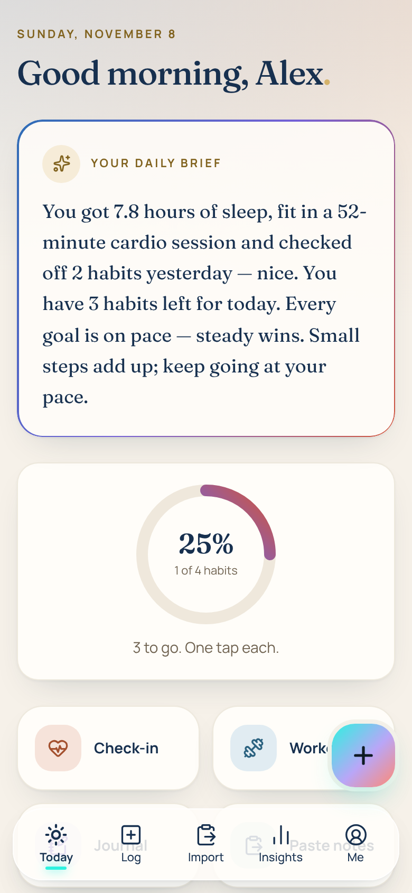
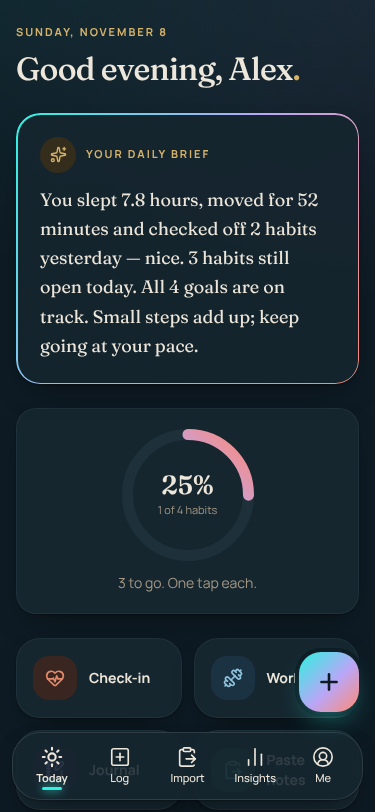
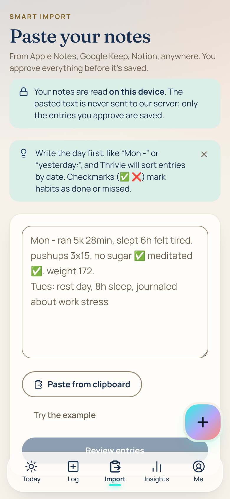
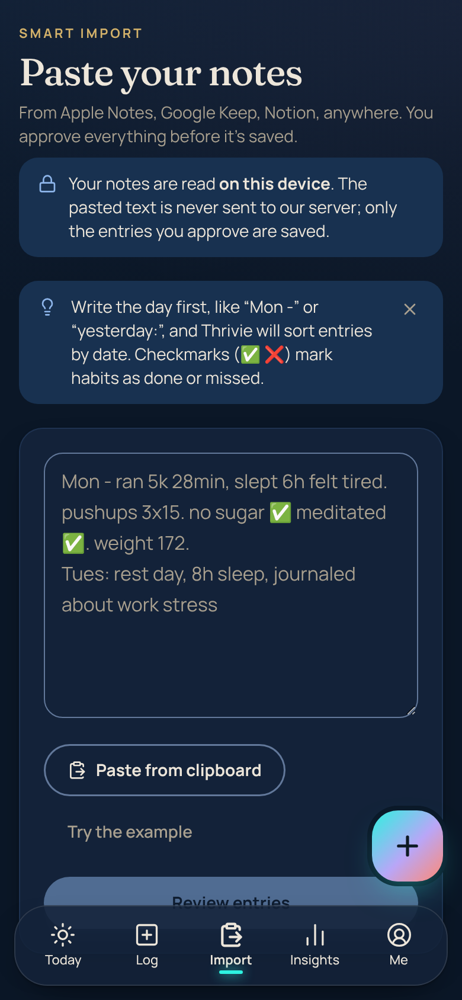
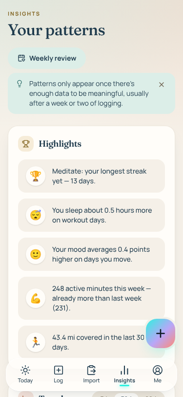
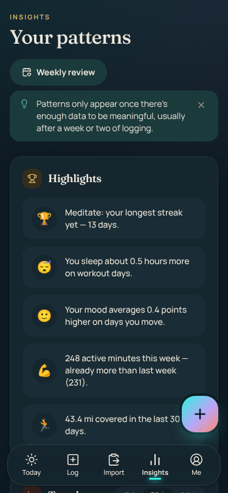
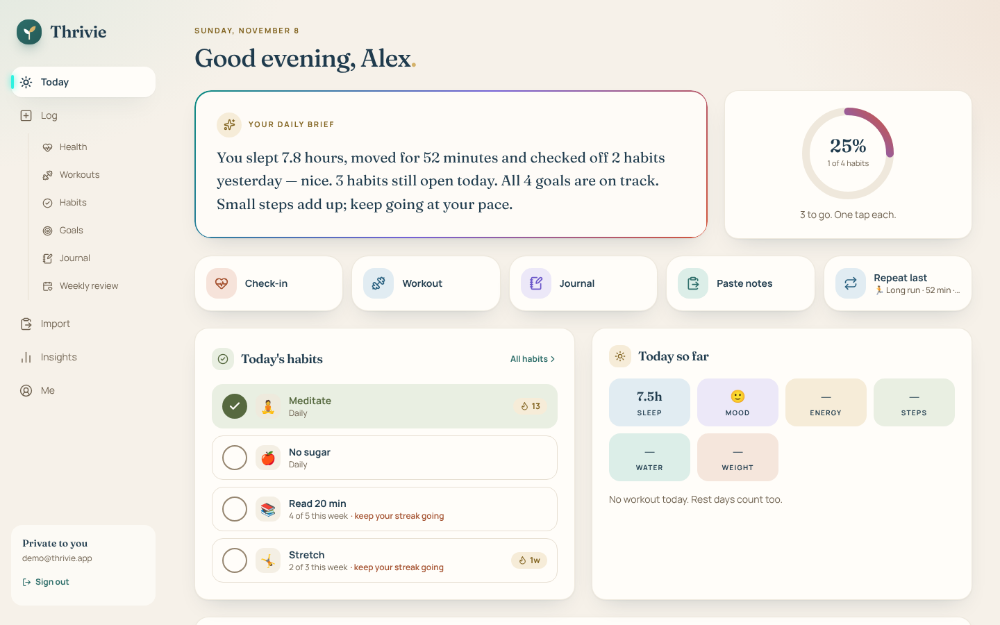
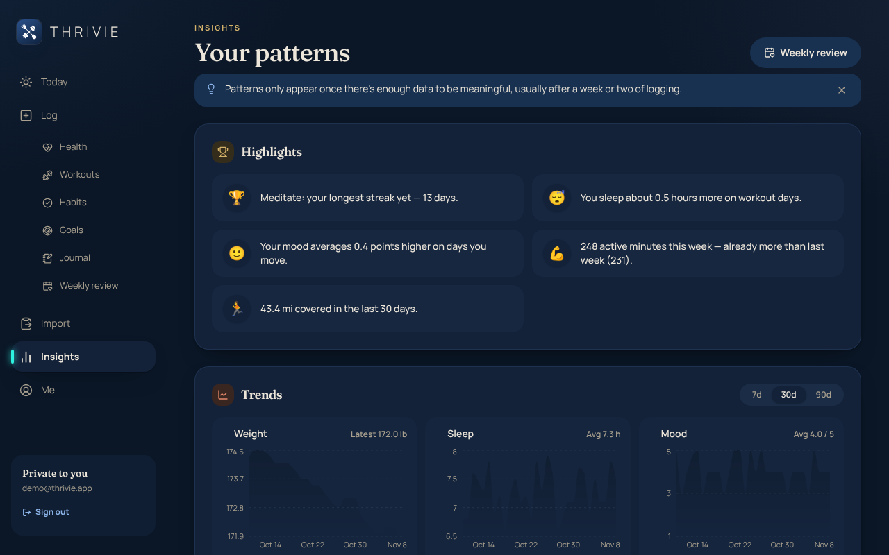

<p align="center"></p>

# Thrivie · Fitness & Nutrition

A simple, beautiful, mobile-first wellness app where people track **health, workouts, meals, habits, goals and a journal**, with a calm dashboard, highlights, a daily brief, and a **free Smart Import** that turns notes-app text into entries on your own device.

**Private by design.** Every account's data is separated by the database itself. Journal text, meal names, notes, photos and voice notes are encrypted. Pasted notes never leave your device. No paid AI services, no ads, no tracking. See [SECURITY.md](SECURITY.md).

> Thrivie is for personal tracking only. It isn't medical advice.

## Screens

| | Phone (light) | Phone (dark) |
|---|---|---|
| Today |  |  |
| Smart Import |  |  |
| Insights |  |  |

Desktop:  

The visual system pairs the Thrivie brand navy (#1E3A64) with Coastal Earth accents. It is documented in [`design/style-guide.html`](design/style-guide.html), including every WCAG AA contrast check. The logo is built from the approved artwork (designer vector mark, plus the wordmark traced from the approved card at 99.77% overlap) and shown everywhere through one `<Logo>` component. See [`design/brand/README.md`](design/brand/README.md).

---

## What's inside

- **Today**: a daily brief (frosted glass with an iridescent edge), a habit progress ring, one-tap habits, quick-log buttons, goal rings and highlights.
- **Log**: check-ins (weight, sleep and its quality, water, mood, energy, steps, custom metrics), workouts (with exercises or distance and pace, plus *Repeat last*), meals (breakfast, lunch, dinner or snack, with optional calories, protein, carbs and fat, one-tap *Have it again* and optional daily targets), habits (every day, specific days, or N times per day/week/month; tap counters; streaks; heatmaps), goals (linked to a metric, workout type or habit so they update themselves) and a journal (prompts, mood, photos, voice notes, dictation, search).
- **Import**: Smart Import, explained below.
- **Insights**: 7/30/90-day trends, weekly workout volume, habit heatmap, goal progress, highlights and a weekly review.
- **Nutrition**: food diary plus a simple daily meal plan and 7-day view built from 44 meals calculated from USDA FoodData Central values (respects diet and allergies, one-tap swap, optional hidden calories, safety rules for under-18s, pregnancy and low BMI).
- **Me**: profile and units, friendly timezone picker, Body & Goals, theme, visible modules, reminders, health sync (Apple Shortcuts / Android), two-step verification, Smart Import shorthand, export (JSON/CSV), restore, delete all data, delete account.
- **On every screen**: a quick-add button on phones (2 taps to any entry), Undo toasts instead of confirm dialogs, skeleton loaders, offline logging with sync, installable as a PWA, light/dark/system themes, and reduced-motion support.

### Smart Import (free, on your device)

1. **Tier 1, always on.** A rule-based parser (chrono-node + Fuse.js) reads notes **as you paste**, entirely in the browser, and shows a live preview.
   - It splits notes by day and resolves "Mon", "yesterday" or "11/3" in your timezone.
   - It finds sleep, weight, water, steps, mood, energy, workouts (distance, time, sets × reps), meals ("lunch: chicken salad 520 cal, 40g protein", "had salmon for dinner"), habits from ✅/❌, goal progress and journal reflections.
   - Every field has a confidence score.
2. **Tier 2, optional.** A small on-device model (WebLLM, Qwen2.5-0.5B) runs in a Web Worker on devices with WebGPU.
   - It's hidden elsewhere and off by default; turning it on means a one-time download.
   - It only re-reads snippets Tier 1 was unsure about. Its output is schema-validated, and any failure falls back to Tier 1.
3. **Review.** Entries are grouped by date. Low-confidence fields are highlighted. You can edit, remove or approve each one, or use **Approve all**. Duplicates are checked against your existing entries before anything is overwritten.
4. **Learning.** Your corrections become personal shorthand ("bb" → Bench press) for next time. You can view and edit it in **Me**.

**Accuracy** (`npm test`): **100%** of 76 expected facts across 26 messy sample notes (the tuning set), and **96.8%** of 31 facts across 12 *held-out* notes written after tuning.

---

## Run it locally

Needs Node.js 20+ and PostgreSQL 14+.

```bash
npm install
cp .env.example .env            # point POSTGRES_PRISMA_URL / POSTGRES_URL_NON_POOLING at your local Postgres
npm run gen:key                 # paste the output into ENCRYPTION_KEY in .env
# add DEMO_PASSWORD=<12+ characters of your choice> to .env
npm run setup                   # apply migrations (incl. RLS) + create two demo accounts
npm run dev                     # http://localhost:3000
```

Demo logins: **demo@thrivie.app** and **demo2@thrivie.app**, both with the `DEMO_PASSWORD` you set in `.env` (there is no built-in default). Each has 30 days of sample data. Seeding refuses to run in production.

`npm install` also turns on the repo's pre-commit hook (`.githooks/pre-commit`), which blocks commits that contain secrets or key/env/log files. For a deeper scan, install [gitleaks](https://github.com/gitleaks/gitleaks) (`brew install gitleaks`); the hook uses it automatically when present. GitHub also runs gitleaks over the full history on every push and pull request (`.github/workflows/secret-scan.yml`), so a secret can't slip in from a machine without the hook.

| Command | |
|---|---|
| `npm test` | Unit + integration tests (parser accuracy, dates, schemas, encryption, brief, streaks, **RLS isolation against Postgres**). Uses a database whose name must end in `_test`, e.g. `thrivie_test`; put its URL in `TEST_DATABASE_URL`, in your shell or a git-ignored `.env.test`. |
| `node e2e/matrix.cjs` | Playwright: 7 viewports × light/dark × key screens, axe accessibility checks, no horizontal scroll, and 200% text size. Needs the app running and seeded, and `DEMO_PASSWORD` set. |
| `node e2e/lighthouse.cjs` | Lighthouse (mobile) for sign-in and Today |
| `npm run db:new-migration` | Create a migration after you change `prisma/schema.prisma` |
| `npm audit --omit=dev` | Dependency check (0 known vulnerabilities at release) |

Latest results:
- **Tests:** 187 passing.
- **Responsive and accessibility matrix:** 275/275 checks clean (9 viewports incl. iPad, light/dark, every screen, overflow detection).
- **Lighthouse (mobile):**
  - Sign-in: Performance 100 · Accessibility 100 · Best Practices 100 · SEO 91
  - Today: 94 · 100 · 100 · 100

---

## Free hosting on Vercel (works from an iPad)

Vercel runs the app; a free **Neon** Postgres database, added from inside Vercel, stores the data.

1. **Database (one click):** in your Vercel project, open **Storage → Create Database → Neon** (free plan) and connect it to the project for all environments. This adds `POSTGRES_PRISMA_URL` and `POSTGRES_URL_NON_POOLING` automatically.
2. **Keys:** open `https://<your-app>/setup` (it works before setup is finished). It generates `ENCRYPTION_KEY`, `CRON_SECRET` and `SIGNUP_CODE` in your browser. Add them under **Settings → Environment Variables**.
3. **Deploy the new version:** merge this branch into `main` on GitHub (or set **Settings → Git → Production Branch** to this branch). Vercel rebuilds, and the build applies the database migrations, including all security policies, automatically.
4. **Reminders (optional):** at [cron-job.org](https://cron-job.org), call `https://<your-app>/api/cron/reminders?secret=<CRON_SECRET>` **every hour**.
5. **Email (optional, recommended):** add `RESEND_API_KEY`, `EMAIL_FROM` and `APP_URL` (Resend's free tier is enough). This turns on "Forgot password?" reset emails, password-change notices and email sign-in links. Without email, people can still reset a forgotten password with the recovery key they create in **Me → Account**.
6. Open the site in Safari, create your account with the signup code, then tap **Share → Add to Home Screen**.

> **Keep a safe copy of `ENCRYPTION_KEY`.** Without it, encrypted entries can't be read. To rotate it, set the old key as `ENCRYPTION_KEY_PREVIOUS` and the new one as `ENCRYPTION_KEY`.

---

## Tech

Next.js 15 (App Router) · TypeScript · Tailwind CSS 4 · PostgreSQL with forced Row Level Security · Prisma · Zod · Recharts (lazy-loaded) · chrono-node · Fuse.js · WebLLM (optional, lazy-loaded) · Fraunces + Manrope (self-hosted, no font requests to Google) · web-push · Vitest · Playwright + axe · Lighthouse.

```
prisma/schema.prisma            data model
prisma/migrations/*_rls         Row Level Security: policies, restricted role, forced on every table
src/lib/db.ts                   scoped data client (RLS context + app-level scoping + encryption)
src/lib/crypto.ts               AES-256-GCM field/attachment encryption
src/lib/auth.ts, authActions.ts sessions, 2FA, magic links, rate limits
src/lib/import/parser.ts        Smart Import Tier 1 (on-device)
src/lib/import/onDevice.ts      Smart Import Tier 2 (WebLLM, optional)
src/lib/briefText.ts            template daily brief
src/middleware.ts               CSP nonce, CSRF origin check, auth redirect
src/app/(app)/                  Today, Log, Import, Insights, Me + module pages
tests/                          unit + integration tests, parser fixtures
e2e/                            viewport/a11y matrix, Lighthouse
```

### Why these choices
- **Postgres + RLS, with our own small auth layer instead of Supabase Auth:** RLS is enforced by the database, and the same code runs on Neon, Supabase or any Postgres. Keeping auth in the app made it fully testable here, including 2FA, magic links, rate limits and breach checks. The RLS migration works on Supabase too.
- **Self-hosted fonts:** avoids sending every visitor's IP to a third party and keeps the CSP strict.
- **Template-based daily brief:** free, private and consistent. When the on-device model is already downloaded, an optional "Rewrite with on-device AI" polish is offered. It's rejected if any number changes.
